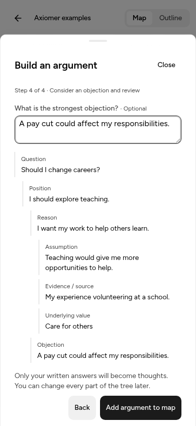
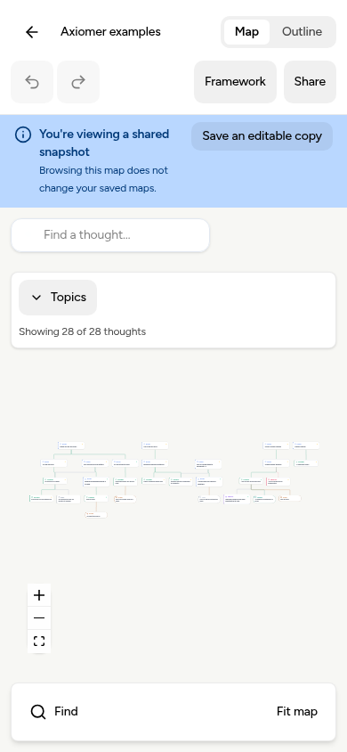
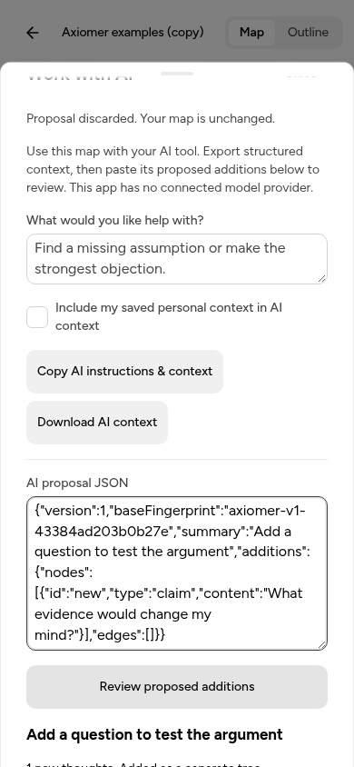
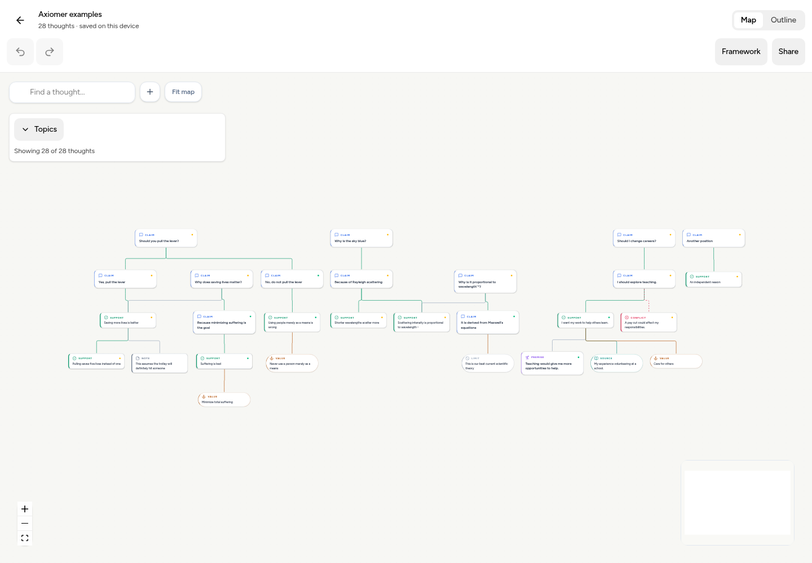

# Axiomer: a framework for understandable reasoning

Axiomer is a structured reasoning document with a map and an outline. The canvas helps you see connections; the framework explains what to put there and why it belongs there.

## Start with one argument

Choose **Build argument** on the map. The four steps ask you to:

1. **State a question and your position.** Make the question specific enough to discuss. State one position that someone could reasonably disagree with.
2. **Give a reason and expose its assumption.** A reason explains why you hold the position. The assumption is the bridge between the reason and the conclusion.
3. **Name evidence and an underlying value.** A source is something another person can check. A value explains why an outcome matters to you. Either can be left open when you don't yet know it.
4. **Consider the strongest objection, then review.** Write the objection in language its supporter would recognize. Check the resulting tree before adding it.

Only the answers you enter become nodes. The entire addition can be undone in one action. You can return to any thought to add more support, a different objection, context, or a reused foundation.

Example:

```text
Should I change careers?                         Question
└─ I should explore teaching.                    Position
   ├─ I want my work to help others learn.         Reason
   │  ├─ Teaching would offer more opportunities. Assumption
   │  ├─ My volunteering experience.              Evidence/source
   │  └─ Care for others.                         Underlying value
   └─ A pay cut could affect my responsibilities. Objection
```

The argument is now understandable without knowing a graph notation. A source can support a reason without proving it. A value can explain a preference without establishing a factual claim.

## Values, core beliefs and personality have different roles

Open **Framework → Your foundations & personality profile**.

- **Base values:** things that matter to you, such as care, autonomy or honesty. The builder can reuse one as an underlying value.
- **Core beliefs:** statements you currently accept. The builder can use one as a position to examine. They remain revisable claims.
- **Personality and context:** your own description of how you think and the experiences shaping your outlook. The app does not infer a type, diagnosis or score.

This context is saved separately on the current device. It is excluded from sharing and AI exports unless you explicitly include it. A shared profile is descriptive context, not evidence for the argument.

The existing ten node types remain the underlying language: claim, premise, support, conflict, note, value, source, limit, bedrock and preference. A question and a position both use claim nodes; their position in the tree explains their role. **Grounded** describes a structural connection to a foundation; it does not mean true, proven or morally correct.

## Build one tree on another

Select a thought and choose **Attach a tree**, or use **Framework → Attach a saved tree or snapshot**.

1. Choose a saved map or a snapshot file.
2. Choose the root whose tree you want to copy.
3. Choose the thought it belongs beneath, or add it as a separate tree.
4. Choose whether it supports, challenges or adds context.
5. Review the actual additions, then attach.

Attachments are independent copies with new identities. Changing the copy does not rewrite the original map. There is no automatic merging of similarly named beliefs. Existing foundations can be deliberately reused through the map inspector. Shared reasoning branches survive deletion of an unrelated parent.

## Keep large maps legible

**Topics** chooses a starting tree. **Focus branch** scopes the view to the selected thought. Parent links let you move back upward. **Show all** returns to the overview, while the visible-count message explains any rendering limit.

The map lays out at most 200 thoughts at once, with depth choices and full-document search. Search can find and reveal a thought outside the current view. The outline is scoped to at most 150 thoughts and five levels; selecting a deeper topic continues the exploration. Shared branches are expanded under one parent and referenced from others so a highly connected map does not expand exponentially.

The document remains intact when a view is narrowed. Imports allow up to 10,000 thoughts, 50,000 connections and 5 MiB. Pure tests exercise 10,000-node traversal and validation; browser tests exercise navigation in a 1,001-node document. These are tested bounds, not a promise of unlimited canvas performance on every device.

## Share an understandable snapshot

**Share** offers a read-only link, a snapshot JSON file and a readable Markdown outline. Large documents use a file when their link would exceed 12,000 characters.

A recipient browses a snapshot without changing their saved maps, then chooses **Save an editable copy** when they want to work on it. Hash changes load the newly selected shared document. Personal context stays excluded by default; anyone with an included-context link or file can read it. Snapshot files can be attached to another map through the same preview flow.

Sharing is a snapshot workflow. It does not synchronize simultaneous editing between people.

## Let an AI tool interact with the structure

Open **Framework → AI context & proposed additions**:

1. Describe the help you want, such as a missing assumption or a strong objection.
2. Copy or download the structured context and instructions for your chosen AI tool.
3. Paste its proposal JSON into Axiomer.
4. Review the summary, attachment relationship and proposed reasoning tree.
5. Apply or discard. Applying is one undoable change.

The app currently provides a model-independent exchange interface. It does not call an AI provider itself. Proposals can add reasoning, not delete or replace existing work. A proposal made for an older map is rejected at review and again at apply time.

The packet describes the permitted node and edge structure. Profile context is opt-in. There are no simulated judgments or invented argument-strength scores.

Minimal proposal:

```json
{
  "version": 1,
  "baseFingerprint": "COPY_THE_CURRENT_PACKET_FINGERPRINT",
  "summary": "Add a question about what would change the conclusion",
  "additions": {
    "nodes": [
      { "id": "proposed-question", "type": "claim", "content": "What evidence would change my mind?" }
    ],
    "edges": []
  }
}
```

For an attachment, also supply `attachTo` with an existing nonterminal node ID and `relation` with `supports`, `conflicts` or `annotates`. Internal proposal edges use the existing semantic direction: child → parent for supports/conflicts/annotates; parent → foundation for grounds/cites. Proposals are checked for missing references, duplicate identities, circular paths, unsafe metadata and size limits before they can be applied.

## Research behind the interaction choices

- [Apple: Gestures](https://developer.apple.com/design/human-interface-guidelines/gestures) and [Discoverable design](https://developer.apple.com/videos/play/wwdc2021/10126/) support visible, familiar actions alongside gesture shortcuts. Axiomer provides labelled Build, Topics, Focus, Undo and Redo actions rather than making a gesture the only way to do essential work.
- [Apple: Sheets](https://developer.apple.com/design/human-interface-guidelines/sheets) and [Undo and redo](https://developer.apple.com/design/human-interface-guidelines/undo-and-redo) informed reachable form actions, unfinished-draft protection and reversible batch operations.
- [Purdue OWL: Organizing your argument](https://owl.purdue.edu/owl/general_writing/academic_writing/establishing_arguments/organizing_your_argument.html) informed the distinction between a claim, evidence, its connecting assumption, an objection and a response. The prompts adapt that structure to Axiomer's existing types.
- [tldraw persistence](https://tldraw.dev/docs/persistence) and [AI integration](https://tldraw.dev/docs/ai) informed the separation between document data and viewing state, and the use of structured, validated AI actions. The existing React Flow canvas is retained.
- [Meta Astryx](https://github.com/meta/astryx/blob/main/plugins/astryx/skills/astryx/SKILL.md) supplies the new sheets, inputs, selectors, buttons and layout components.

## Verification

Run `npm run typecheck`, `npm test`, `npm run build`, then `npm run test:browser`. For an installed Chromium, set `PLAYWRIGHT_CHROMIUM_EXECUTABLE_PATH`; otherwise install Playwright's Chromium. The browser suite checks the guided flow, private context, previewed attachment, share/copy behavior, corrupt-library preservation, hash navigation, AI discard/apply/staleness/undo, responsive widths, short landscape layout and large-map search. Real iPhone keyboard behavior, VoiceOver and long-session ergonomics still need physical-device checks.


## Screenshots from the verified build

| Guided reasoning tree | Shared snapshot |
| --- | --- |
|  |  |

| AI proposal review | Map workspace |
| --- | --- |
|  |  |

Final automated checks: 86 unit tests, 9 browser checks, typecheck and production build pass. Astryx doctor reports zero failures, with the existing external-font verification warning. Vite reports the larger main bundle containing the new interaction components; live collaboration and a connected model provider are future work.
