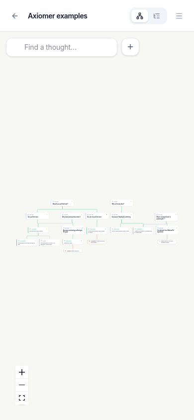
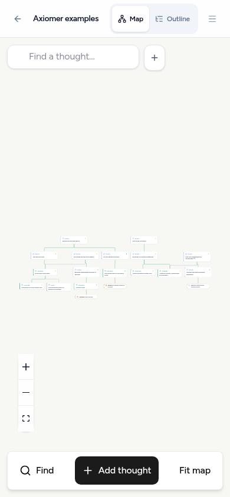
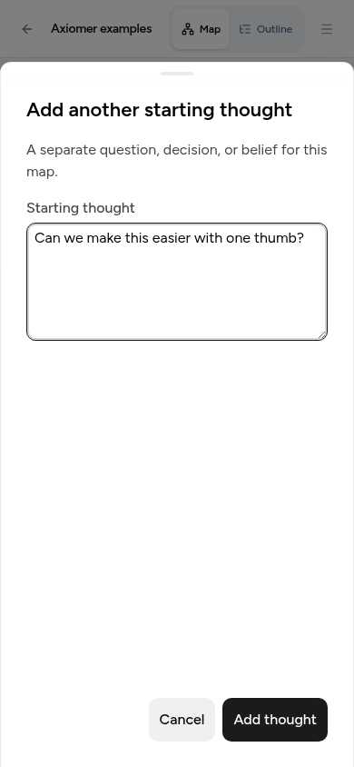

# Map actions within thumb reach

The Map remains the primary workspace, with the existing Outline alternative and graph semantics.

- The mobile map has labelled Find, Add thought, and Fit map actions at the bottom. Its zoom controls leave room for the dock.
- Starting thoughts use an Astryx BottomSheet, TextArea, Heading, Text, and Buttons. The form keeps its actions at the bottom and uses the tall sheet's mobile keyboard accommodation.
- Map and Outline controls now have visible labels, pressed states, and larger targets.
- Existing read-only callbacks continue to control whether creation actions appear.

Astryx Core, CLI and Neutral theme are pinned to 0.7.16. The documented existing-Tailwind coexistence recipe preserves the application's existing theme names. The Map remains lazy-loaded.

Validation: typecheck, 52 unit tests, production build, Astryx doctor (zero failures), mobile create/reload interaction, and overflow checks at 320/390/768/1440 widths. Doctor warns that its external Figtree font import cannot be verified statically. Production builds flag the lazy Map chunk size; this incremental adoption includes BottomSheet's interaction code.

Reference: [Meta Astryx agent skill](https://github.com/meta/astryx/blob/main/plugins/astryx/skills/astryx/SKILL.md).

## Screenshots

| Before | After | Action |
| --- | --- | --- |
|  |  |  |
